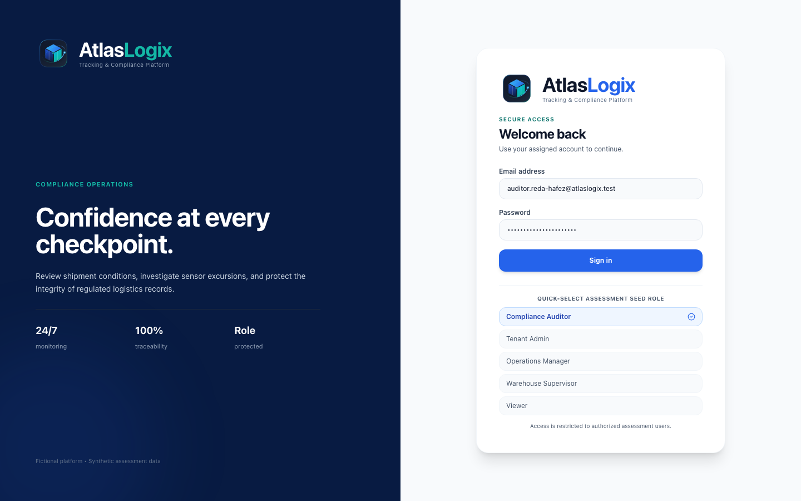
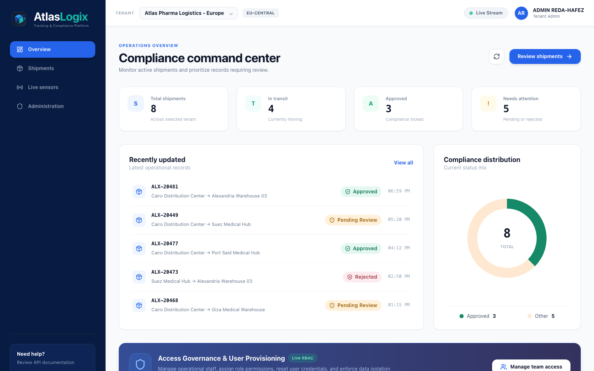
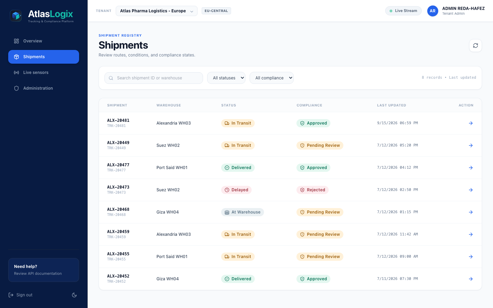
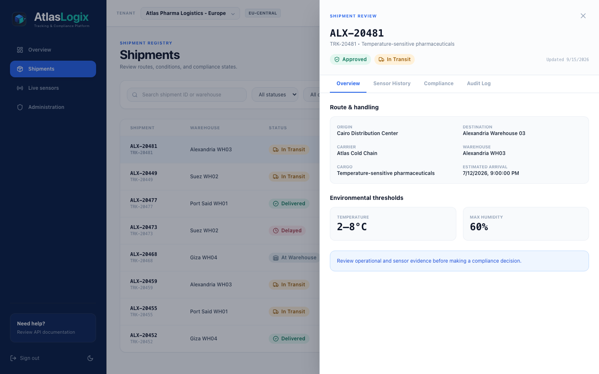
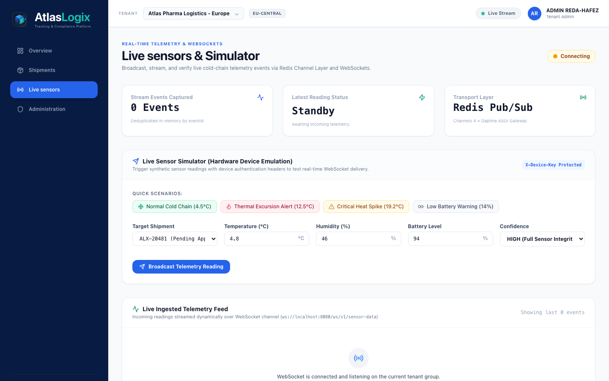
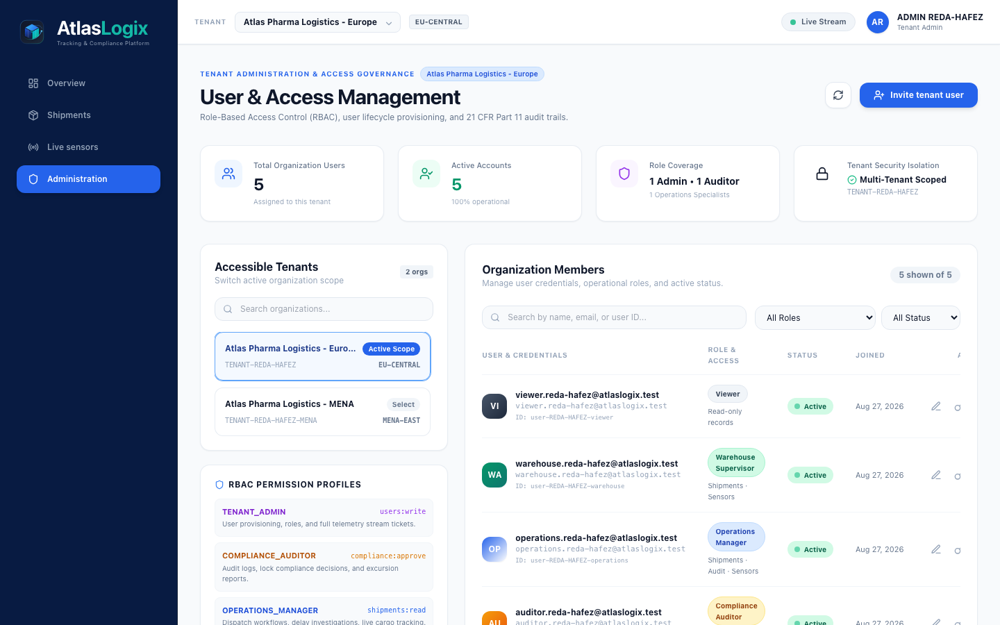
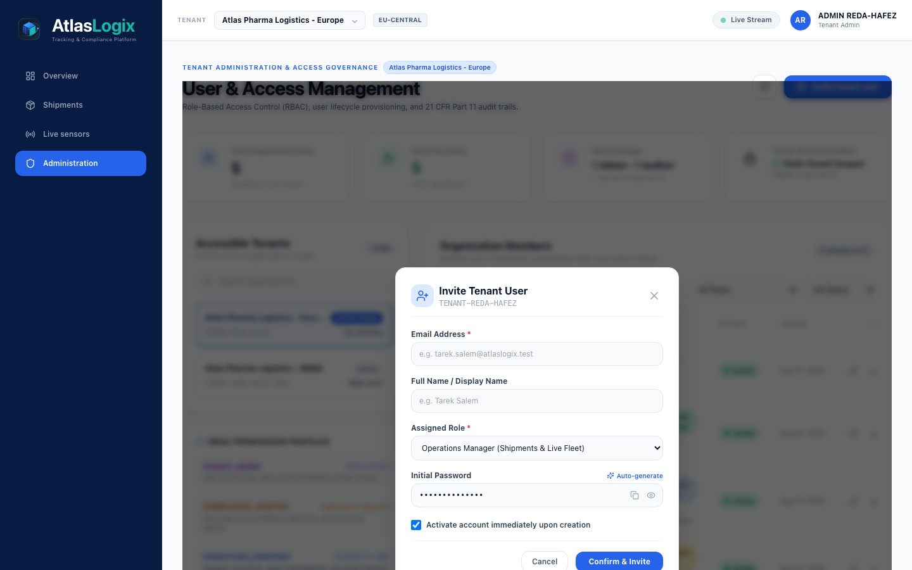
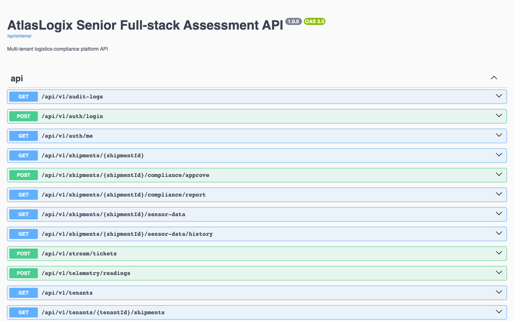
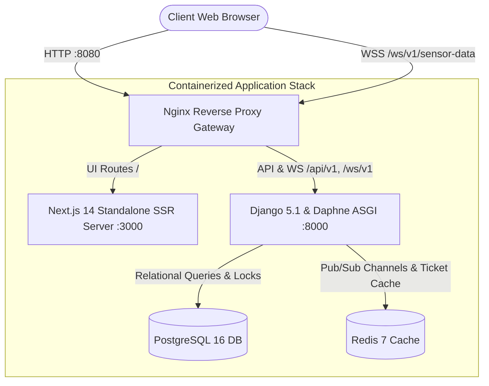

<div align="center">

# 🧊 AtlasLogix
### Enterprise Cold-Chain IoT Telemetry & Regulatory Compliance Platform

[](LICENSE)
[](https://www.python.org/)
[](https://www.djangoproject.com/)
[](https://nextjs.org/)
[](https://www.docker.com/)
[](https://www.postgresql.org/)
[](https://redis.io/)
[](#-regulatory-compliance--data-integrity)
[](#-testing--quality-assurance)

<p align="center">
  A mission-critical, multi-tenant IoT cold-chain logistics platform engineered for real-time monitoring of temperature-sensitive pharmaceuticals, vaccines, biologics, and clinical trial supplies with strict <strong>FDA 21 CFR Part 11</strong> compliance and <strong>GxP</strong> regulatory audit trails.
</p>

[Explore Interface](#-visual-showcase--interface-tour) •
[System Architecture](#-system-architecture) •
[Quickstart](#-quickstart-guide) •
[Key Features](#-core-capabilities) •
[API Specs](#-rest--websocket-api-endpoints)

</div>

---

## 📸 Visual Showcase & Interface Tour

### 1. Authentication & Multi-Tenant Access Portal
*Secure entry gateway featuring single-click role credential presets, tenant scope selection, and custom isometric 3D telemetry identity.*


---

### 2. Operations Command Center & Analytics Dashboard
*Real-time executive dashboard displaying shipment counts, in-transit fleet status, compliance approval distributions, and RBAC governance banners.*


---

### 3. Shipments Directory & Dynamic Filtering
*Comprehensive cargo repository with faceted search, destination filtering, carrier pills, compliance state badges, and quick inspection drawers.*


---

### 4. Shipment Excursion Analysis & 21 CFR Part 11 Compliance Sign-off
*High-resolution telemetry graphs, thermal excursion threshold monitoring, immutable electronic signatures, and human-auditor review workflows.*


---

### 5. Live Sensors & Telemetry Dispatcher Simulator
*Real-time hardware simulator broadcasting IoT temperature, humidity, battery, and vibration telemetry over WebSockets and Redis Pub/Sub with SHA-256 idempotency verification.*


---

### 6. Access Governance & Enterprise User Management Console
*Tenant-scoped user administration suite featuring role coverage KPI cards, organization switcher, members directory with role badges, and 1-click status toggling.*


---

### 7. User Provisioning & Role Delegation Dialog
*Seamless tenant user onboarding modal with client-side validation, role selection, auto-generated secure credentials, and immediate activation controls.*


---

### 8. Interactive OpenAPI 3.0 / Swagger UI Specification
*Fully documented RESTful API schema with interactive request runners, security schemes, parameter descriptions, and response contracts.*


---

## 🏛️ System Architecture



### Technical Stack & Specifications
- **Gateway**: Nginx 1.27 reverse proxy with unified routing for Web, REST API, and WebSockets.
- **Backend & Real-Time**: Python 3.12, Django 5.1, Django REST Framework 3.15, Django Channels 4.1, Daphne 4.1.
- **Frontend**: Next.js 14.2 (App Router, Standalone output), TypeScript 5.5, React 18.3, Chart.js 4.4, Lucide Icons.
- **Data Tier**: PostgreSQL 16 (Relational models, row-level concurrency locks, audit entries).
- **In-Memory Broker**: Redis 7-alpine (ASGI channel layers, stream ticketing, caching).
- **Container Infrastructure**: Multi-stage Dockerfiles with non-root execution profiles.

---

## ✨ Core Capabilities

### 1. Real-Time IoT Telemetry Stream (WebSockets & Redis)
- High-throughput WebSocket stream endpoint (`/ws/v1/sensor-data`) powered by Redis Channel Layer.
- Authenticated via **single-use ephemeral tickets** (`/api/v1/stream/tickets`) with strict time-to-live (TTL) expiration.
- Zero-latency broadcast to browser clients with instant UI flash highlights and excursion alerts.

### 2. Cryptographic Idempotency & Ingestion Engine
- `POST /api/v1/telemetry/readings` requires an `X-Device-Key` header and an `Idempotency-Key`.
- Computes SHA-256 hash over canonical payload keys (`shipmentId`, `temperature`, `humidity`, `vibration`, `batteryLevel`, `confidence`, `recordedAt`).
- Replayed identical events return `200 OK` (`replayed: true`) without creating duplicate database rows.
- Conflicting payloads with matching event IDs return `409 EVENT_CONFLICT`.
- WebSocket broadcasts are strictly dispatched via `transaction.on_commit()` to prevent phantom dirty-read events.

### 3. Regulatory Compliance & Concurrency Locks (21 CFR Part 11)
- Authoritative approval workflow restricted to `COMPLIANCE_AUDITOR` with `compliance:approve` permission.
- Pessimistic row-level database locking (`select_for_update()`) prevents race conditions and concurrent double-sign-offs.
- Every state transition, user invitation, role alteration, or compliance decision generates an immutable `AuditEntry` with actor identity, timestamp, and field diffs.

### 4. Enterprise User Management & Granular RBAC
- Complete administration console (`/administration`) for managing organization team members.
- Fine-grained role hierarchy:
  - **`TENANT_ADMIN`**: Full platform control, user provisioning, role alteration, and stream tickets.
  - **`COMPLIANCE_AUDITOR`**: Sensor history analysis, excursion reporting, and authoritative compliance approval.
  - **`OPERATIONS_MANAGER`**: Fleet oversight, shipment lifecycle dispatch, delay investigation.
  - **`WAREHOUSE_SUPERVISOR`**: Receiving facility intake and environmental sensor review.
  - **`VIEWER`**: Read-only observation across shipments and audit trails.
- Instant 1-click status toggle (Active / Deactivated) immediately terminating unauthorized sessions.

### 5. Multi-Tenant Data Isolation
- Queries and event subscriptions are strictly scoped to the user's active `tenantId`.
- Accessing a resource belonging to a different tenant returns `404 Not Found` to prevent data reconnaissance.

### 6. Interactive Hardware Emulation Simulator
- Integrated sandbox at `/sensors` allowing operators to simulate sensor hardware.
- Real-time sliders for temperature (-20°C to +30°C), humidity, battery level, and confidence scores.
- One-click presets: Normal Cold Chain (+4.5°C), Thermal Excursion (+12.5°C), Critical Heat Spike (+19.2°C), Low Battery (14%).

---

## 🚀 Quickstart Guide

### 1. Prerequisites
- [Docker](https://docs.docker.com/get-docker/) (24.0+) & [Docker Compose](https://docs.docker.com/compose/) (v2.0+)
- Git

### 2. Clone & Launch
```bash
# Clone the repository
git clone https://github.com/redahafez/AtlasLogix_Senior_Fullstack_Assessment_REDA-HAFEZ.git
cd AtlasLogix_Senior_Fullstack_Assessment_REDA-HAFEZ

# Configure environment variables
cp .env.example .env

# Launch the complete containerized stack
docker compose up --build -d
```

The stack will automatically:
1. Initialize PostgreSQL 16 and Redis 7 containers.
2. Apply Django database migrations.
3. Import seed fixture data idempotently.
4. Build Next.js 14 production bundle and start Daphne ASGI server.
5. Expose Nginx reverse proxy gateway at **`http://localhost:8080`**.

---

## 🔑 Demo Seed Accounts & Credentials

| Role | Email | Password | Primary Organization Scope |
| :--- | :--- | :--- | :--- |
| **Tenant Administrator** | `admin.reda-hafez@atlaslogix.test` | `7P1OhjscS32sQjYWFCra2w` | `TENANT-REDA-HAFEZ` (Europe) |
| **Compliance Auditor** | `auditor.reda-hafez@atlaslogix.test` | `4wLJerbLyBGBGZG8t8IIjA` | `TENANT-REDA-HAFEZ` (Europe) |
| **Operations Manager** | `operations.reda-hafez@atlaslogix.test` | `eaeGnGIcL8Y7JvaxOHAylw` | `TENANT-REDA-HAFEZ` (Europe) |
| **Warehouse Supervisor** | `warehouse.reda-hafez@atlaslogix.test` | `X3mJ_Ii5pWcdMNEiLma9ow` | `TENANT-REDA-HAFEZ` (Europe) |
| **Viewer** | `viewer.reda-hafez@atlaslogix.test` | `DTp6ZNQR7o4_j9l7201uGA` | `TENANT-REDA-HAFEZ` (Europe) |

*Quick-select buttons on the login screen automatically populate these credentials for rapid evaluation.*

---

## 🌐 Public Gateway Endpoints (`:8080`)

| Service / Endpoint | URL | Description |
| :--- | :--- | :--- |
| **Web Portal** | `http://localhost:8080/` | Main application UI (Login, Dashboard, Shipments, Sensors, Users) |
| **API Documentation** | `http://localhost:8080/api/docs/` | Interactive OpenAPI 3.0 / Swagger UI |
| **OpenAPI Schema** | `http://localhost:8080/api/schema/` | Raw OpenAPI YAML / JSON schema definition |
| **Liveness Probe** | `http://localhost:8080/health/live` | Process liveness healthcheck (`200 OK`) |
| **Readiness Probe** | `http://localhost:8080/health/ready` | Dependency healthcheck verifying PostgreSQL & Redis |
| **WebSockets Telemetry** | `ws://localhost:8080/ws/v1/sensor-data` | Real-time sensor stream connection (requires ticket) |

---

## 🧪 Testing & Quality Assurance

### 1. Automated Backend Test Suite (Django)
Run the comprehensive test suite covering RBAC, isolation, concurrency, idempotency, and readiness probes:
```bash
docker exec atlaslogix_backend python manage.py test core.tests
```
*Result: **17 out of 17 tests passing (100% OK)**.*

### 2. End-to-End & Accessibility Tests (Playwright)
Run the end-to-end browser workflow with automated WCAG 2.1 AA accessibility audits:
```bash
cd tests_e2e
npm install
npx playwright test
```

### 3. Chaos & Dependency Failure Probe Test
Verify that `/health/ready` accurately reports service outages by temporarily stopping Redis:
```bash
docker stop atlaslogix_redis
curl -i http://localhost:8080/health/ready
# Returns: HTTP/1.1 503 Service Unavailable with {"checks": {"redis": "failed"}}

docker start atlaslogix_redis
curl -i http://localhost:8080/health/ready
# Returns: HTTP/1.1 200 OK with {"status": "ok"}
```

---

## 📄 License & Attribution

This project is open-source software licensed under the **[MIT License](LICENSE)**.

Developed by **[Reda Hafez](https://github.com/redahafez)**.
